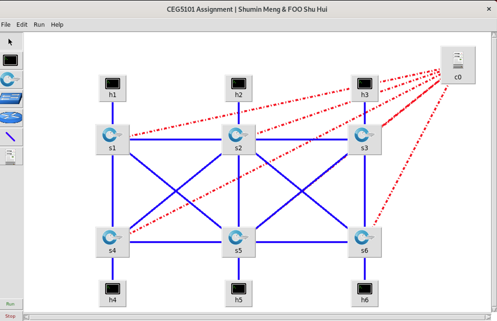
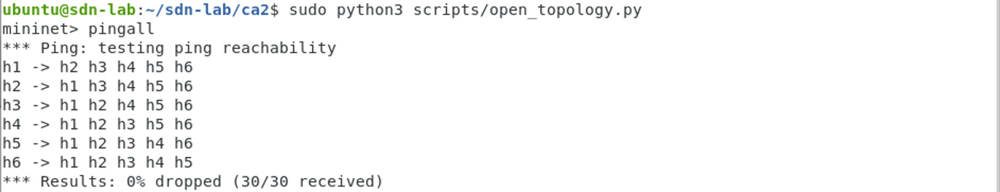

# CEG5101 CA2 — Part 1

Shumin Meng & FOO Shu Hui

The mesh topology from `ceg_mesh_topo.py`, opened in MiniEdit and connected to
a Ryu controller. The controller uses Dijkstra for unicast routing and a
minimum spanning tree for broadcast traffic.

## Requirements

The setup script supports Ubuntu 20.04 with Python 3.8. MiniEdit needs a
Linux desktop session. For a Mac VM, see [VM setup](docs/mac-setup.md).

## Install

```bash
git clone https://github.com/MILLOPE/CEG5101_CA2.git
cd CEG5101_CA2
bash scripts/setup.sh
```

Run these commands inside Ubuntu. The script installs Mininet, Open vSwitch,
Tk and Ryu, using `.venv` for the controller's Python dependencies.

## Run

Open two terminals in the Ubuntu desktop. Start both in the project directory.

**Terminal 1 — controller**

```bash
bash scripts/run_controller.sh
```

Leave it running. `ready=False` is normal before the network starts.

**Terminal 2 — MiniEdit**

```bash
sudo python3 scripts/open_topology.py
```

The saved topology opens automatically. Click **Run**. Terminal 2 will show
the `mininet>` prompt; MiniEdit may pause while that CLI is active.
Wait for terminal 1 to show:

```text
Topology: 6 switches, 11/11 links; ready=True
```

The switches connect to the controller at `127.0.0.1:6653`. The red dotted
lines in MiniEdit show these controller connections.



## Check the network

Enter these commands at `mininet>`:

```text
pingall
h1 ping -c 5 10.0.0.6
```

`pingall` should return `0% dropped (30/30 received)`.

Our run passed all 30 directed host-pair checks with 0% packet loss.



The h1-to-h6 path should be:

```text
h1 → s1 → s2 → s6 → h6
```

The switch-path cost is `5 + 14 = 19`. Terminal 1 logs the learned MAC
addresses, selected switches and cost. To inspect the forwarding rules:

```text
sh ovs-ofctl -O OpenFlow13 dump-flows s1
sh ovs-ofctl -O OpenFlow13 dump-flows s2
sh ovs-ofctl -O OpenFlow13 dump-flows s6
```

Priority-100 rules forward packets to the listed output ports. The priority-0
rule sends unmatched packets to the controller.

### Automated checks

First type `exit` at `mininet>` to stop the interactive network. Keep the
controller running, then run in terminal 2:

```bash
sudo python3 tests/check_topology.py
sudo xvfb-run -a python3 tests/check_network.py
```

The first test compares the MiniEdit file with the supplied Python topology.
The second starts a MiniEdit network, runs `pingall`, then sends 10 h1-to-h6
pings. It checks that the corresponding counters increase by 10 at s1, s2 and
s6, and stay unchanged at the other switches. The test stops its network on exit.

## Stop

Type `exit` at `mininet>`, close MiniEdit, then press **Ctrl+C** in the
controller terminal.

If a crash leaves old interfaces behind, close the old topology and run:

```bash
sudo mn -c
```

This cleans up Mininet networks on the VM. Stop any other Mininet experiments
before using it.

## How the controller works

Each host hi connects to si and has IP `10.0.0.i/24`. The network has 6 host
links and 11 switch-to-switch links, all at 40 Mbps. Host links have a 15 ms
delay. Switch-to-switch delays are used as static routing costs:

| Link | Cost | Link | Cost |
|---|---:|---|---:|
| s1–s2 | 5 | s2–s3 | 10 |
| s4–s5 | 15 | s5–s6 | 20 |
| s1–s4 | 8 | s2–s5 | 12 |
| s3–s6 | 7 | s1–s5 | 18 |
| s2–s4 | 6 | s2–s6 | 14 |
| s3–s5 | 9 | | |

These values match the delays in `ceg_mesh_topo.py`. The teacher's reference
controller has different costs for some links. Host-link delays are excluded
from the reported switch-path cost.

The controller discovers links with LLDP and waits for the complete topology
to remain stable for one discovery cycle. It learns host locations from
host-facing ports. Known destinations follow Dijkstra's lowest-cost path;
broadcast and unknown destinations use the spanning tree to avoid loops.

This version covers normal forwarding. If a configured link disappears,
forwarding pauses until the complete topology returns. Traffic monitoring,
source blocking and dynamic costs will be added in later parts.

## Files

```text
controller/   Ryu path controller
topology/     Supplied Python topology and MiniEdit file
scripts/      Installation, launch and topology export scripts
tests/        Topology and forwarding checks
vendor/       Python 3 MiniEdit and its license
docs/         Mac VM setup
results/      Local logs and test output, excluded from Git
```

After editing the Python topology, regenerate the MiniEdit file:

```bash
sudo python3 scripts/generate_topology.py
sudo python3 tests/check_topology.py
```

Logs and test results are saved in `results/`.

## Common problems

| Problem | What to check |
|---|---|
| `ready=False` after clicking Run | Six switches, eleven links, OpenFlow 1.3 and controller port 6653. Use the supplied launcher for LLDP discovery. |
| Python 3 cannot import Mininet | Rerun setup; Ubuntu's package may only provide Python 2 bindings. |
| Tk cannot open a display | Start MiniEdit from a terminal in the Ubuntu desktop. |
| `RTNETLINK ... File exists` | Stop the old topology, run `sudo mn -c`, then restart. |
| Port 6653 is occupied | Stop the controller already using that port. |
| Ryu fails to import | Use the project's `.venv` and pinned dependencies. |

For a shell-only session, the same topology can also run with this command.
Keep the controller running and close any existing MiniEdit network first:

```bash
sudo mn --custom topology/ceg_mesh_topo.py --topo meshTopo \
  --controller remote,ip=127.0.0.1,port=6653 \
  --switch ovs,protocols=OpenFlow13 --link tc --mac
```

Use MiniEdit when demonstrating the assignment's first task.

## Test notes and sources

Tested on Ubuntu 20.04 (aarch64): all 30 ping checks passed, and forwarding
counters confirmed the s1–s2–s6 path. Ryu dependencies were also checked in a
fresh Python 3.8 environment. Full setup on a new VM has not been tested.

The topology and reference routing approach come from the CEG5101 CA2 course
materials. MiniEdit's author credits and license are kept in `vendor/`.
