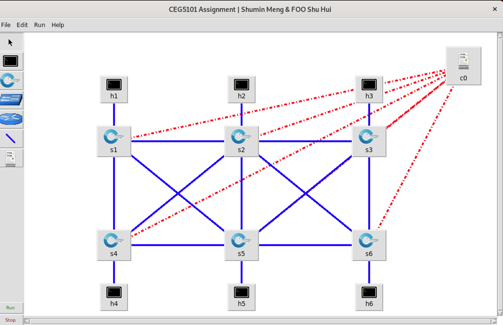
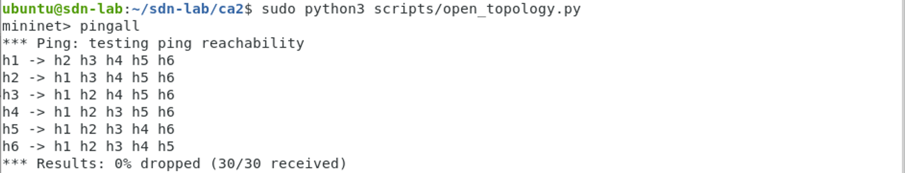
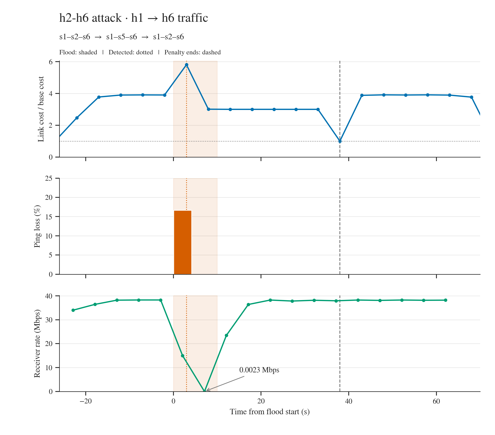

# CEG5101 CA2 — Qn1–4

MiniEdit mesh topology with a Ryu controller for shortest-path routing,
ICMP traffic monitoring, source IP blocking and dynamic link costs.

## Setup

Use Ubuntu 20.04 with Python 3.8 and a desktop session for MiniEdit.
For a Mac VM, see [VM setup](docs/mac-setup.md).
Run the following inside Ubuntu:

```bash
git clone https://github.com/MILLOPE/CEG5101_CA2.git
cd CEG5101_CA2
bash scripts/setup.sh
```

The script installs Mininet, Open vSwitch, Ryu, hping3, iperf, tcpdump and
the plotting packages. Ryu uses the project's `.venv`.

## Start the network

Open two Ubuntu terminals in the project directory.

Terminal 1 — start the controller:

```bash
bash scripts/run_controller.sh
```

Terminal 2 — open MiniEdit:

```bash
sudo python3 scripts/open_topology.py
```

Click **Run**. Wait for terminal 1 to show `ready=True`.
Terminal 2 will show the `mininet>` prompt.



## Qn1: connectivity

At `mininet>`:

```text
pingall
h1 ping -c 5 h6
```

Our run returned `0% dropped (30/30 received)`.
The normal h1→h6 path is s1–s2–s6, with base switch-path cost 15.



## Qn2: anomaly detection and blocking

Start a fresh controller and topology for this test. At `mininet>`, first
build the normal baseline:

```text
h2 ping -c 20 h3
```

Wait for `Q2 BASELINE: IP=10.0.0.2` in terminal 1, then send the flood:

```text
h2 hping3 --icmp --flood 10.0.0.3
```

Let it run for about 10 seconds, then press **Ctrl+C** in terminal 2.
Look for `Q2 ANOMALY` and `Q2 BLOCKED` in terminal 1. Check connectivity and
the drop rule:

```text
h2 ping -c 3 -W 1 h3
h1 ping -c 3 h6
sh ovs-ofctl -O OpenFlow13 dump-flows s2
```

h2 should receive no replies after blocking; h1 should still receive replies.
The flow table should contain a priority-5000 rule for `nw_src=10.0.0.2`
with `actions=drop`.

For the automated version, run `bash scripts/run_qn2.sh`.
[Qn2 measurements and plots](docs/qn2.md) include the saved runs and
the command for redrawing them.

## Qn3: dynamic link costs

Qn3 runs in the same controller. Each inter-switch link uses:

```text
cost = base_cost + 30 × utilisation + 20 × anomaly
```

Base costs follow the supplied `resilient_controller.py`; unspecified links
have cost 10. Routing costs are separate from the physical TCLink delays.
Utilisation is the larger directional TX rate divided by 40 Mbps, capped
at 1. Anomaly penalties have a 30-second hold and are cleared at the next
statistics update; the source IP stays blocked.

On a fresh network, run this at `mininet>` to test the load term:

```text
h3 iperf -s -p 5001 &
h1 iperf -c 10.0.0.3 -p 5001 -t 120 -i 5
```

Open the newest `results/data/qn3-*.jsonl` file. Each row records a link's
`utilisation`, `anomaly`, `dynamic_cost` and `normalized_cost`.
Use the Qn2 ping/flood test to check the anomaly term.

Load updates affect new flows. Existing paths are recalculated when an
anomaly is detected, a penalty expires, or the topology changes. Idle rules
left by `pingall` are excluded from anomaly-path marking.

[Earlier Qn3 tests](docs/qn3.md) used delay-based costs and are kept separately.

## Qn4: rerouting and performance

Run all three cases:

```bash
bash scripts/run_qn4.sh
```

If you used an earlier setup, install the measurement tools once:
`sudo apt install iperf tcpdump`.

Each case starts a fresh network, builds the source's ping baseline, and
runs h1→h6 TCP traffic for 90 seconds. A 10-second flood starts after
25 seconds. The source path is checked against s2–s3, s2–s6 or s5–s6.
The three cases take about six minutes.

Results go to `results/qn4/<run>/<case>/`:

- `qn4.png`: paths before/during/after, attacked-link cost, probe loss and TCP throughput.
- `analysis-output.txt`: the same short summary printed in the terminal.
- `result.json`: paths, blocking checks and before/during/after measurements.
- `metrics.csv`: throughput and loss in 5-second bins.
- `route_costs.csv`: old and new path costs using the same logged cost snapshot.

TCP paths come from OpenFlow rules. Loss is measured with one h1→h6 ping
per second; these probes can use a different path from TCP. The `during`
phase covers flood start through penalty expiry. Original logs, JSONL
samples and ICMP captures are retained.

At the first observed reroute, the latest logged costs gave:

| Attack | Old path cost | New path cost |
| --- | ---: | ---: |
| h2→h3 | 73.01 | 20.00 |
| h2→h6 | 89.86 | 20.00 |
| h5→h6 | 73.21 | 30.00 |

These are dynamic costs from one snapshot, rather than the initial base
path cost of 15. [Cost comparisons](examples/qn4/route_costs.csv) include
the observation time and sample age.

All three saved cases blocked the source and restored h1's original route.
The h2→h6 case lost one of 100 ping probes and had a 5-second interval at
0.0023 Mbps; the same TCP connection recovered and finished. Off-path
attacks can also move h1 because routing uses the current load costs.

The saved h2→h6 run prints:

```text
PASS h2-h6
Source 10.0.0.2: drop rules on 6/6 switches
Flood check (2.18 s): drop +119701, forward +0
TCP paths: s1-s2-s6 / s1-s5-s6 / s1-s2-s6
ICMP probes: 99/100 replies, 1.0% loss
Receiver Mbps (before / during / after): 37.77 / 29.00 / 38.17
Lowest 5-second receiver rate: 0.0023 Mbps
Sampled path cost: 89.86 -> 20.00
```

[Controller, drop-rule and ping output](docs/qn4-output.md) shows the original
log excerpts behind this summary.



Other cases: [h2→h3](docs/images/qn4-h2-h3.png),
[h5→h6](docs/images/qn4-h5-h6.png). [Saved measurements](examples/qn4/phases.csv).

Shading marks the flood command. The dotted line marks blocking; the dashed
line marks the first observed return to the original TCP route. Cost can
rise again when TCP returns to that link.
The loss bars show individual 5-second windows, not whole-run loss.

## Stop or repeat

Type `exit` at `mininet>`, close MiniEdit, then press **Ctrl+C** in terminal 1.
Restart both for another test; Qn2 block rules do not expire automatically.

If old interfaces remain after a crash, close other Mininet experiments and
run this in an Ubuntu terminal before restarting:

```bash
sudo mn -c
```

## Notes

The controller uses Dijkstra for known destinations and an MST for flooding.
Qn2 samples ICMP Echo Requests every 5 seconds, uses EMA α=0.3, and detects
rates above three times the previous baseline. Qn3 updates link costs from
port statistics every 5 seconds. Forwarding pauses if a configured link is
missing.

The topology and reference approach come from the CEG5101 CA2 materials.
MiniEdit's original credits and license are in `vendor/`.

Plots are PNG. Edit `tools/plot_style.py` for colors and fonts. Text uses
Times New Roman when available, falling back to STIXGeneral; math uses STIX.
