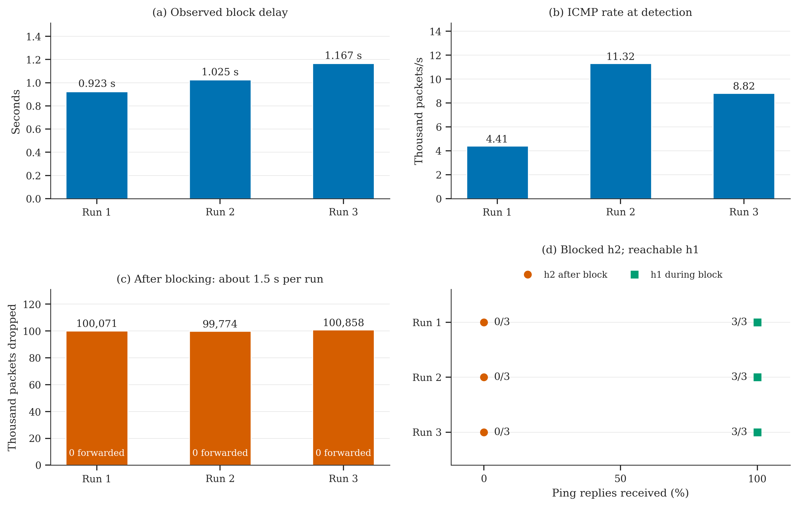

# CEG5101 CA2 — Qn1 and Qn2

MiniEdit mesh topology with a Ryu controller for shortest-path routing,
ICMP traffic monitoring and source IP blocking.

## Setup

Use Ubuntu 20.04 with Python 3.8 and a desktop session for MiniEdit.
For a Mac VM, see [VM setup](docs/mac-setup.md).
Run the following inside Ubuntu:

```bash
git clone https://github.com/MILLOPE/CEG5101_CA2.git
cd CEG5101_CA2
bash scripts/setup.sh
```

The script installs Mininet, Open vSwitch, Ryu, hping3 and the plotting
packages. Ryu uses the project's `.venv`.

## Start the network

Open two Ubuntu terminals in the project directory.

Terminal 1 — start the controller:

```bash
bash scripts/run_controller.sh
```

Terminal 2 — open MiniEdit:

```bash
sudo python3 scripts/open_topology.py
```

Click **Run**. Wait for terminal 1 to show `ready=True`.
Terminal 2 will show the `mininet>` prompt.


## Qn1: connectivity

At `mininet>`:

```text
pingall
h1 ping -c 5 h6
```

Our run returned `0% dropped (30/30 received)`.
The normal h1→h6 path is s1–s2–s6, with switch-path cost 19.


## Qn2: anomaly detection and blocking

Start a fresh controller and topology for this test. At `mininet>`, first
build the normal baseline:

```text
h2 ping -c 20 h3
```

Wait for `Q2 BASELINE: IP=10.0.0.2` in terminal 1, then send the flood:

```text
h2 hping3 --icmp --flood 10.0.0.3
```

Let it run for about 10 seconds, then press **Ctrl+C** in terminal 2.
Look for `Q2 ANOMALY` and `Q2 BLOCKED` in terminal 1. Check connectivity and
the drop rule:

```text
h2 ping -c 3 -W 1 h3
h1 ping -c 3 h6
sh ovs-ofctl -O OpenFlow13 dump-flows s2
```

h2 should receive no replies after blocking; h1 should still receive replies.
The flow table should contain a priority-5000 rule for `nw_src=10.0.0.2`
with `actions=drop`.

## Optional: automated test and plots

```bash
bash scripts/run_qn2.sh
```

This checks blocking and legitimate connectivity while the flood is active.
It starts and stops its own test network. Data goes to `results/qn2/`, and
figures to `figures/`.

To redraw the saved automated run:

```bash
bash scripts/run_qn2.sh plot
```

The [saved Qn2 results](docs/qn2.md#saved-results) include measurements and
figures from a separate automated run. Edit `tools/plot_style.py` to adjust colors, font and figure size.
Plots are saved as PNG.

Three fresh runs also passed the blocking and connectivity checks:



[Repeat measurements](examples/qn2/repeats/summary.csv)

## Stop or repeat

Type `exit` at `mininet>`, close MiniEdit, then press **Ctrl+C** in terminal 1.
Restart both for another test; Qn2 block rules do not expire automatically.

If old interfaces remain after a crash, close other Mininet experiments and
run this in an Ubuntu terminal before restarting:

```bash
sudo mn -c
```

## Notes

The controller uses Dijkstra for known destinations and an MST for flooding.
Qn2 samples ICMP Echo Requests every 5 seconds, uses EMA α=0.3, and detects
rates above three times the previous baseline. Link costs are static and
currently come from topology delays. Forwarding pauses if a configured link
is missing.

The topology and reference approach come from the CEG5101 CA2 materials.
MiniEdit's original credits and license are in `vendor/`.
