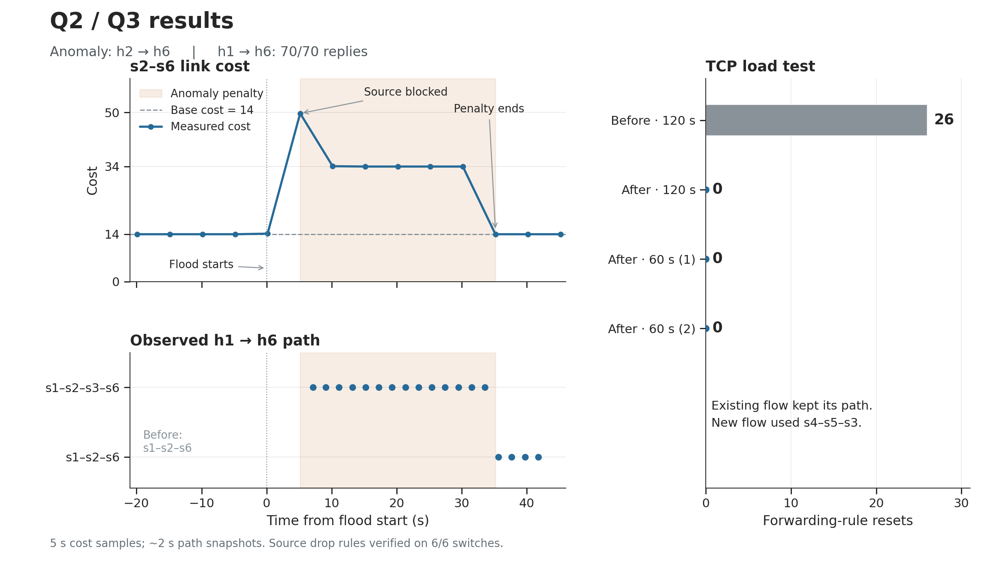
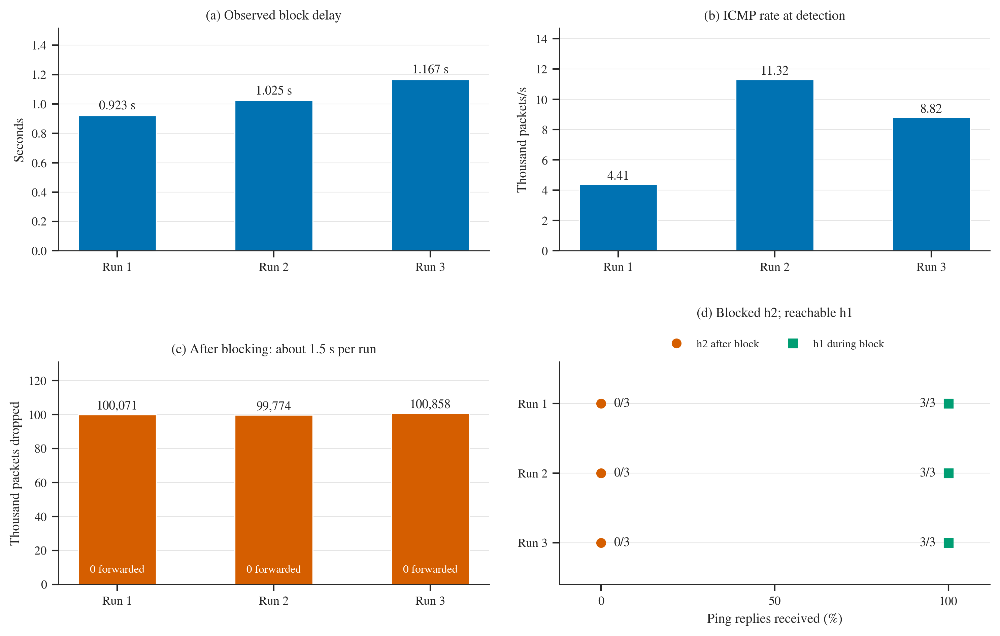

# CEG5101 CA2 — Qn1–4

MiniEdit mesh topology with a Ryu controller for shortest-path routing,
ICMP traffic monitoring, source IP blocking and dynamic link costs.

## Setup

Use Ubuntu 20.04 with Python 3.8 and a desktop session for MiniEdit.
For a Mac VM, see [VM setup](docs/mac-setup.md).
Run the following inside Ubuntu:

```bash
git clone https://github.com/MILLOPE/CEG5101_CA2.git
cd CEG5101_CA2
bash scripts/setup.sh
```

The script installs Mininet, Open vSwitch, Ryu, hping3 and the plotting
packages. Ryu uses the project's `.venv`.

## Start the network

Open two Ubuntu terminals in the project directory.

Terminal 1 — start the controller:

```bash
bash scripts/run_controller.sh
```

Terminal 2 — open MiniEdit:

```bash
sudo python3 scripts/open_topology.py
```

Click **Run**. Wait for terminal 1 to show `ready=True`.
Terminal 2 will show the `mininet>` prompt.


## Qn1: connectivity

At `mininet>`:

```text
pingall
h1 ping -c 5 h6
```

Our run returned `0% dropped (30/30 received)`.
The normal h1→h6 path is s1–s2–s6, with base switch-path cost 15.


## Qn2: anomaly detection and blocking

Start a fresh controller and topology for this test. At `mininet>`, first
build the normal baseline:

```text
h2 ping -c 20 h3
```

Wait for `Q2 BASELINE: IP=10.0.0.2` in terminal 1, then send the flood:

```text
h2 hping3 --icmp --flood 10.0.0.3
```

Let it run for about 10 seconds, then press **Ctrl+C** in terminal 2.
Look for `Q2 ANOMALY` and `Q2 BLOCKED` in terminal 1. Check connectivity and
the drop rule:

```text
h2 ping -c 3 -W 1 h3
h1 ping -c 3 h6
sh ovs-ofctl -O OpenFlow13 dump-flows s2
```

h2 should receive no replies after blocking; h1 should still receive replies.
The flow table should contain a priority-5000 rule for `nw_src=10.0.0.2`
with `actions=drop`.

## Qn3: dynamic link costs

Qn3 runs in the same controller. Each inter-switch link uses:

```text
cost = base_cost + 30 × utilisation + 20 × anomaly
```

Base costs follow the supplied `resilient_controller.py`; unspecified links
have cost 10. The physical TCLink delays are unchanged. This keeps all three
Qn4 attack pairs on their requested links when the baseline flows start.
Utilisation is the larger of the two
directional TX rates divided by 40 Mbps, capped at 1. The anomaly penalty
lasts 30 seconds; the source IP stays blocked.

On a fresh network, run this at `mininet>` to test the load term:

```text
h3 iperf -s -p 5001 &
h1 iperf -c 10.0.0.3 -p 5001 -t 120 -i 5
```

Open the newest `results/data/qn3-*.jsonl` file. Each row records a link's
`utilisation`, `anomaly`, `dynamic_cost` and `normalized_cost`.
Use the Qn2 ping/flood test to check the anomaly term.

Load updates affect new flows. Existing flows keep their paths until an
anomaly is detected, a penalty expires, or the topology changes. This avoids
switching back and forth every statistics interval. Only flows with new
packets contribute destinations to the anomaly-path check; idle rules left
by `pingall` are excluded.

The earlier delay-based runs below verified source blocking on all six switches, no further
forwarding from the blocked source, and penalty recovery. The continuous
h1→h6 ping received 70/70 replies in four runs and 69/70 in one.
Three TCP tests (120, 60 and 60 seconds) had no periodic route resets.



Saved measurements: [anomaly runs](examples/qn3/anomaly_runs.csv) and
[TCP runs](examples/qn3/load_runs.csv). The TCP repeats also included a
5-second h4→h3 flow, which selected s4–s5–s3 under load.
Those h5→h6 tests used s5–s3–s6. Qn4 below uses the reference base costs
and verifies traffic on s5–s6.

## Qn4: rerouting and performance

Run all three cases:

```bash
bash scripts/run_qn4.sh
```

Each case starts a fresh test network. It establishes the source's ICMP
baseline, starts a 90-second h1→h6 TCP flow, and sends a 10-second flood
after 25 seconds. The cases are h2→h3, h2→h6 and h5→h6.
The source path is checked against the requested link before the flood.
The three cases take about six minutes in total.

Results go to `results/qn4/<run>/<case>/`. `qn4.png` shows normalized link
cost, ping loss and receiver throughput over time. TCP paths come from
OpenFlow rules; ping loss comes from captured h1→h6 ICMP probes. These
probes can use a different path from TCP. Throughput and loss use 5-second
bins, with one ping per second.

For each case, `result.json` records the paths, drop-rule checks and
before/during/after measurements; `metrics.csv` contains the plotted rates
and loss. The scripts retain the original logs, JSONL samples and ICMP capture.
The `during` phase runs from flood start through penalty expiry.

The saved tests verified all three target links, source blocking and route
recovery. Loss and temporary throughput drops are retained, including a
5-second interval at 0.0023 Mbps in the h2→h6 run. The same TCP connection
subsequently recovered and finished.
Off-path attacks can also move h1's TCP flow: fresh routing decisions use
the current load costs on its original path.


Other cases: [h2→h3](docs/images/qn4-h2-h3.png),
[h5→h6](docs/images/qn4-h5-h6.png). [Saved measurements](examples/qn4/phases.csv).

## Optional: automated test and plots

```bash
bash scripts/run_qn2.sh
```

This checks blocking and legitimate connectivity while the flood is active.
It starts and stops its own test network. Data goes to `results/qn2/`, and
figures to `figures/`.

To redraw the saved automated run:

```bash
bash scripts/run_qn2.sh plot
```

The [saved Qn2 results](docs/qn2.md#saved-results) include measurements and
figures from a separate automated run. Edit `tools/plot_style.py` to adjust colors, font and figure size.
Plots are saved as PNG.
Text uses Times New Roman when available, with STIXGeneral as the fallback;
math uses STIX. Font settings are in `tools/plot_style.py`.

Three fresh runs also passed the blocking and connectivity checks:



[Repeat measurements](examples/qn2/repeats/summary.csv)

## Stop or repeat

Type `exit` at `mininet>`, close MiniEdit, then press **Ctrl+C** in terminal 1.
Restart both for another test; Qn2 block rules do not expire automatically.

If old interfaces remain after a crash, close other Mininet experiments and
run this in an Ubuntu terminal before restarting:

```bash
sudo mn -c
```

## Notes

The controller uses Dijkstra for known destinations and an MST for flooding.
Qn2 samples ICMP Echo Requests every 5 seconds, uses EMA α=0.3, and detects
rates above three times the previous baseline. Qn3 updates link costs from
port statistics every 5 seconds. Forwarding pauses if a configured link is
missing.

The topology and reference approach come from the CEG5101 CA2 materials.
MiniEdit's original credits and license are in `vendor/`.
