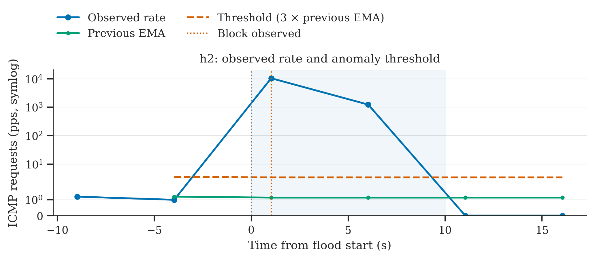
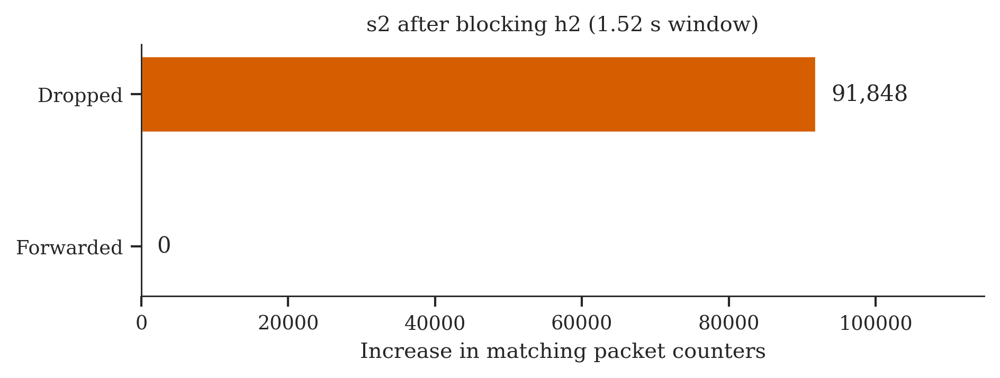
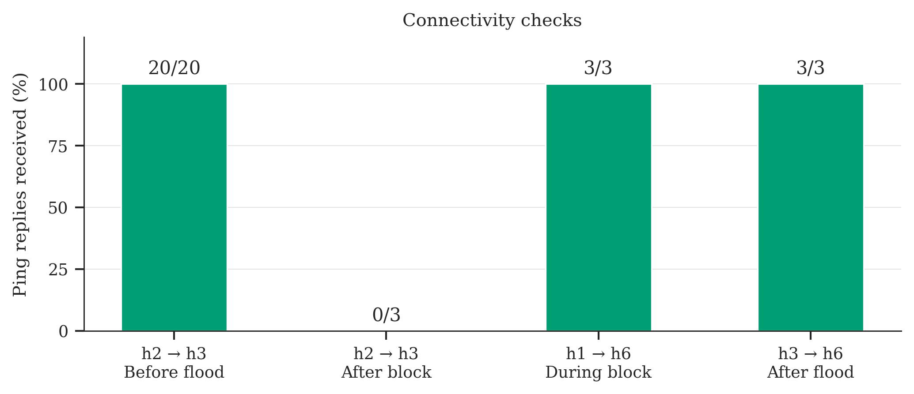

# Qn2: traffic monitoring and source blocking

The controller samples flow counters every 5 seconds, after an initial
10-second delay. It counts ICMP Echo Requests at the source host's ingress
switch, so packets are counted once and Echo Replies do not make the target
look like an attacker.

```text
rate = change in packet count / elapsed seconds
threshold = 3 × previous EMA
new EMA = 0.3 × rate + 0.7 × previous EMA
```

The first positive rate initializes the EMA. Later positive normal samples
update it; zero samples and blocked sources leave it unchanged. Detection uses
the previous EMA before updating it. An anomalous sample is excluded from the
baseline. The source gets a priority-5000 IPv4 drop rule on every switch.

## Try it in MiniEdit

Start the controller and topology as described in the README. Use a fresh
network for this test. At `mininet>`:

```text
h2 ping -c 20 10.0.0.3
```

Wait for `Q2 BASELINE: IP=10.0.0.2` in the controller terminal. Then:

```text
h2 timeout --signal=INT 10 hping3 --icmp --flood 10.0.0.3
h2 ping -c 3 -W 1 10.0.0.3
h1 ping -c 3 10.0.0.6
sh ovs-ofctl -O OpenFlow13 dump-flows s2
```

The flood stops after 10 seconds. Look for `Q2 ANOMALY`, `Q2 BLOCKED`, and a
priority-5000 rule matching `nw_src=10.0.0.2` with `actions=drop`. After the
block, h2's ping should fail and h1's should still work. To check h1 while the
flood is active, use the automated test below.

Qn2 has no automatic unblock. For a repeat, exit the topology, stop the
controller, and start both again. If interfaces remain after a crash, close
other Mininet experiments before running `sudo mn -c`.

## Run the automated test

From the project directory:

```bash
sudo python3 tests/check_qn2.py
```

This starts its own controller on port 16653 and uses bridges q2s1–q2s6.
It builds normal baselines for h1 and h2, checks all six block rules, measures ingress drop
and forwarding counters while the sender is active, and checks h1 and h3
connectivity. It stops its network and controller when finished.

The printed output directory contains `result.json`, `samples.jsonl`, the
controller log, hping output and flow tables. Each controller run also writes
its samples under `results/data/`.

## Plot the results

Use the output directory printed by the test:

```bash
.venv/bin/python tools/plot_qn2.py results/qn2/<run>/result.json
```

Or reproduce the saved example:

```bash
.venv/bin/python tools/plot_qn2.py examples/qn2/result.json
```

Three figures are saved beside the data: rate/EMA/threshold, drop/forward
counter changes, and ping replies. Each is exported as PNG, SVG and PDF.
Edit `tools/plot_style.py` to change colors, font, line width, figure size or
resolution. Seaborn supplies the theme; the plotted values come from the
saved measurements.

The rate is a 5-second average derived from forwarding counters. Once the
drop rule is active, it does not measure the attacker's offered rate. The
counter figure separately checks that continuing packets hit the drop rule.
The rate axis uses a symmetric log scale so the normal baseline and flood
are both visible. Lines connect samples; no smoothing is applied.

The saved example is one run, not an average across repeated trials. Its
small ping checks are connectivity evidence, not Qn4 throughput evaluation.

## Saved results

These figures use `examples/qn2/result.json` and `samples.jsonl` from one
Ubuntu 20.04 aarch64 run. The controller log is included in the same directory.






