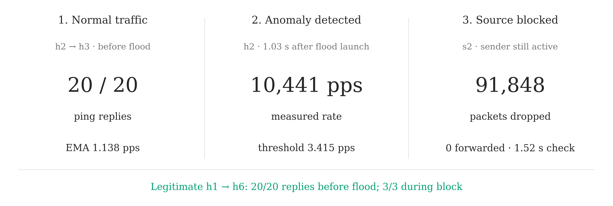

# Qn2: traffic monitoring and source blocking

The controller reads flow counters every 5 seconds. It counts ICMP Echo
Requests at the source host's ingress switch and excludes Echo Replies.

```text
rate = change in packet count / elapsed seconds
threshold = 3 × previous EMA
new EMA = 0.3 × rate + 0.7 × previous EMA
```

The first positive rate initializes the EMA. Normal positive samples update
it. Zero samples and anomalous samples leave it unchanged. When the rate
exceeds the threshold, the controller installs a priority-5000 source-IP drop
rule on every connected switch.

## Run

After setup, run the test and generate the figures:

```bash
bash scripts/run_qn2.sh
```

The test builds normal ping baselines, sends a 10-second h2→h3 ICMP flood,
then checks the block rules, packet counters and legitimate connectivity.
It uses its own controller on port 16653 and bridges q2s1–q2s6, and stops
both when finished. Data goes to `results/qn2/`; figures go to `figures/`.

To redraw the saved example:

```bash
bash scripts/run_qn2.sh plot
```

Edit `tools/plot_style.py` for colors, font, size and line width. Each plot is
exported as PNG, SVG and PDF.

The [README](../README.md#qn2-anomaly-detection-and-blocking) gives the manual
MiniEdit commands. Stop the foreground flood with
Ctrl+C after about 10 seconds. Start a fresh network and controller for each
manual test.

## Saved results

The example is one run on Ubuntu 20.04 (aarch64). Normal h2 pings received
20/20 replies; after blocking, h2 received 0/3. During the block, h1 received
3/3, and h3 received 3/3 in the later connectivity check. The expected change
is that blocked h2 loses connectivity while h1 stays reachable.

The block was observed 1.03 seconds after flood launch in this run. This time
depends on where the flood starts within the 5-second polling cycle. While the
sender was active, s2's drop counter increased by 91,848 and its matching
forwarding counter increased by zero over a 1.52-second observation window.

The upper panel shows interval-average rates; the lower panel shows EMA and
threshold in packets/s. Rates after blocking come
from forwarding counters, so they do not measure the sender's offered load.
The separate counter check is the evidence that packets were being dropped.
The shaded band marks the 10-second flood. The connectivity plots compare
the attacking source and the legitimate host pair separately.




The measurements and controller log are in `examples/qn2/`. These checks
support ICMP source blocking and connectivity in this run.
