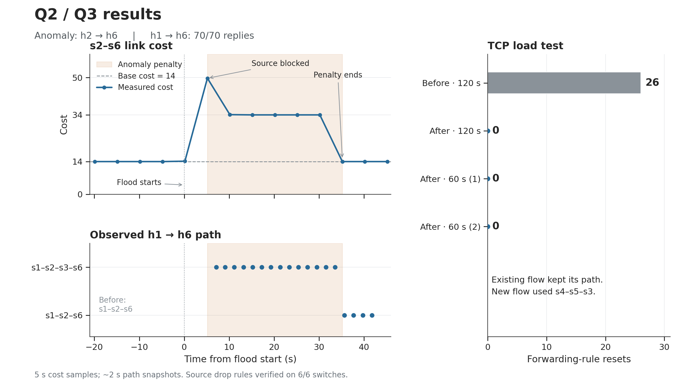

# Earlier Qn3 tests

These runs used the earlier controller, where base costs came from topology
delays. The current controller uses the costs from the supplied
`resilient_controller.py`, with cost 10 for unspecified links.

Five anomaly runs verified source blocking on all six switches, no further
forwarding from the blocked source, and penalty recovery. The continuous
h1→h6 ping received 70/70 replies in four runs and 69/70 in one.

Three TCP tests (120, 60 and 60 seconds) had no periodic route resets.
Each included a 5-second h4→h3 TCP flow, which selected s4–s5–s3 under load.

Measurements: [anomaly runs](../examples/qn3/anomaly_runs.csv) and
[TCP runs](../examples/qn3/load_runs.csv).

In these earlier tests, h5→h6 used s5–s3–s6. They do not verify the
assignment's s5–s6 case. The [current Qn4 tests](../README.md#qn4-rerouting-and-performance)
use the reference costs and verify that direct link.
